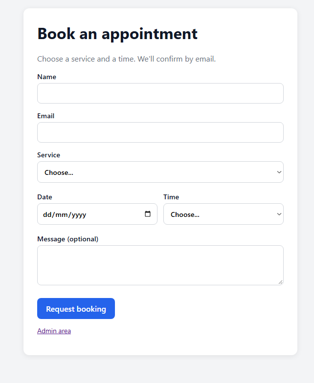
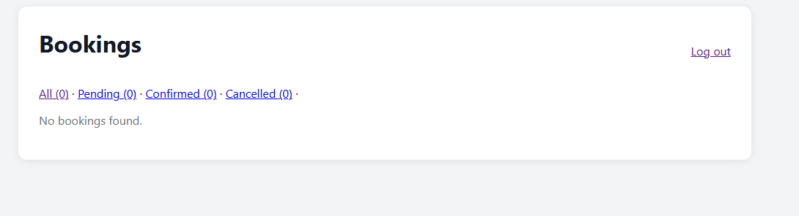
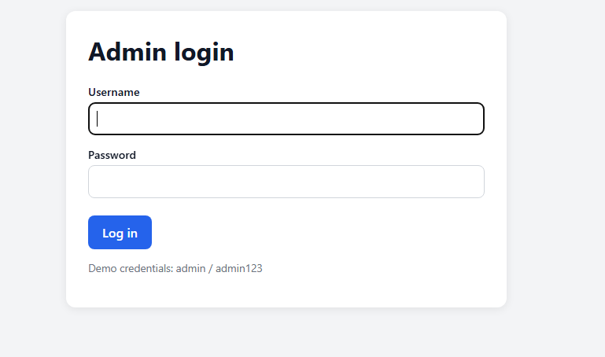

# Booking System (PHP + MySQL)

A small appointment-booking app: a public booking form and a password-protected admin dashboard to confirm, cancel or delete bookings.

## Screenshots



## Features
- Server-side validation (name, email, service, date not in the past, time slots 09:00–16:30)
- Double-booking prevention with a unique database constraint and a friendly error message
- Security basics: prepared statements (PDO), output escaping, CSRF tokens, hashed admin password (`password_hash`), session ID regeneration on login, login attempt limit, honeypot + timing spam checks
- Admin dashboard: filter by status, confirm / cancel / delete
- Responsive layout, no frameworks or dependencies

## Tech
PHP 8+, PDO (MySQL/MariaDB, or SQLite for a zero-setup demo), plain HTML/CSS.

## Run it locally
```bash
git clone <your-repo-url>
cd booking-system
php -S localhost:8000
```
Open http://localhost:8000. By default it uses SQLite and creates the database automatically.
Admin area: http://localhost:8000/admin/ — demo login `admin` / `admin123` (change it, see below).

### Use MySQL / MariaDB instead
1. Import `schema.mysql.sql`.
2. Set environment variables before starting the server:
```bash
export DB_DRIVER=mysql DB_HOST=127.0.0.1 DB_NAME=booking_demo DB_USER=root DB_PASS=yourpassword
php -S localhost:8000
```

### Change the admin password
```bash
php -r 'echo password_hash("your-new-password", PASSWORD_DEFAULT);'
export ADMIN_HASH='<paste the output here>'
```

## Project structure
```
index.php        public booking form
admin/           login, dashboard, status updates
db.php           database connection (MySQL or SQLite)
helpers.php      escaping, CSRF, session helpers
config.php       settings (read from environment variables)
```

## Ideas for extension
Email notifications on new bookings, availability calendar, per-service durations, pagination.
